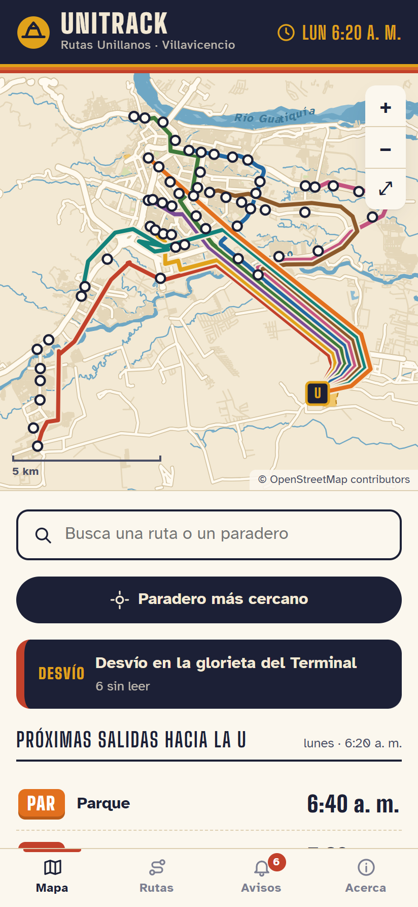
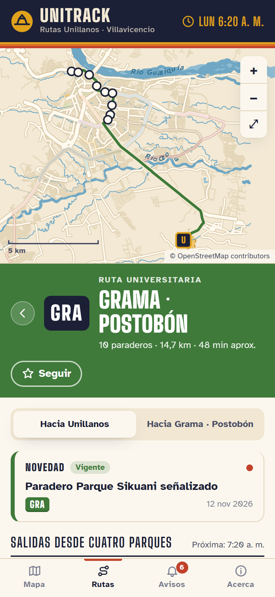
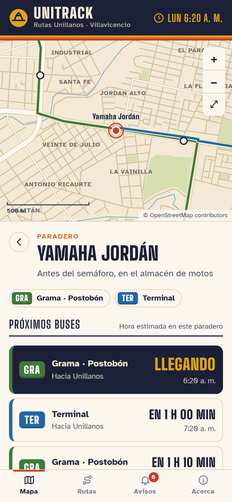
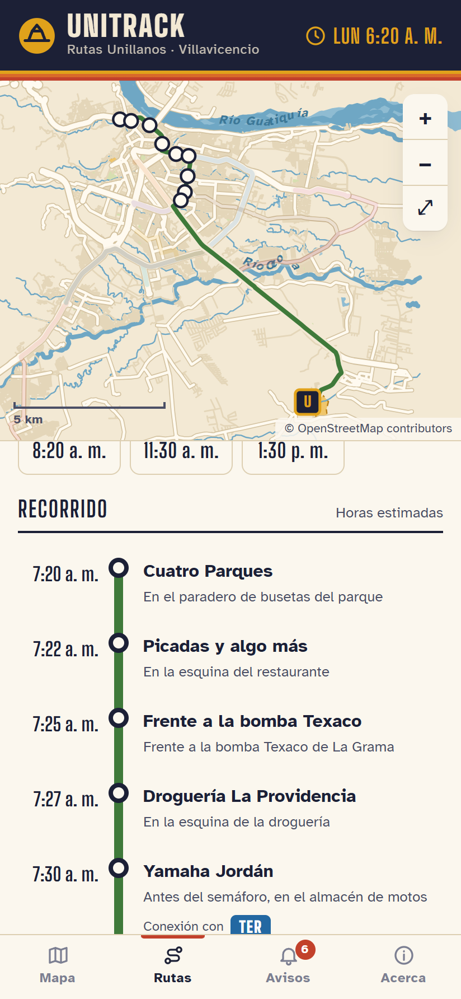
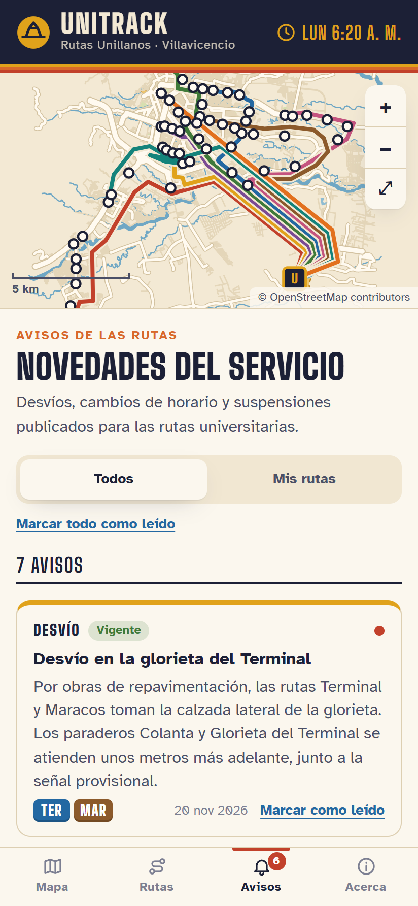
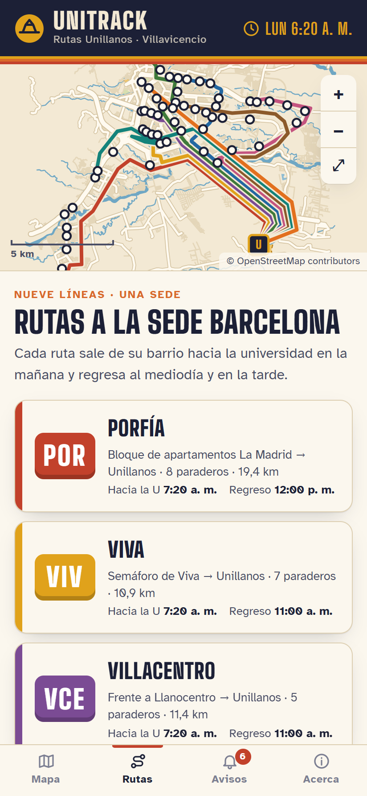
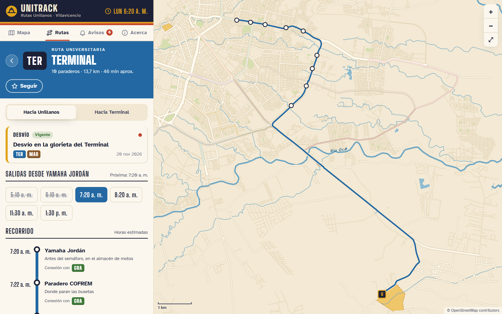

# Unitrack

**Las rutas universitarias de la Universidad de los Llanos, en un cartel que se puede consultar.**

Unitrack es una aplicación web móvil (PWA) para quienes viajan entre los barrios de Villavicencio y la sede Barcelona de la Universidad de los Llanos. Muestra las nueve rutas sobre un mapa propio de la ciudad, los paraderos de cada recorrido, las horas de salida, el próximo bus en cada paradero y los avisos de servicio. Funciona sin servidor, sin claves de API y sin servicios de mapas externos.

<p align="center">
  
  
  
</p>

## Qué ofrece

- **Mapa de las rutas.** Un mapa dibujado a partir de datos de OpenStreetMap, con los recorridos siguiendo las calles reales. Donde varias rutas comparten avenida se dibujan lado a lado, como en un diagrama de transporte. Se puede arrastrar, acercar con la rueda o con dos dedos, y tocar cualquier paradero.
- **Detalle de ruta.** Los dos sentidos (hacia Unillanos y de regreso), las horas de salida y la secuencia de paraderos con la hora estimada de paso para la salida elegida. También muestra las conexiones con otras rutas.
- **Próximo bus en un paradero.** Lista los buses de todas las rutas que pasan por el paradero, con la espera ("en 12 min", "mañana") y la hora estimada.
- **Búsqueda.** Rutas por nombre o código (`COV`, `GRA`…) y paraderos por nombre o referencia, sin importar tildes.
- **Paradero más cercano.** Con permiso de ubicación, propone los tres paraderos más próximos.
- **Avisos por ruta.** Desvíos, cambios de horario y suspensiones con su vigencia. Se pueden marcar como leídos y filtrar por las rutas que sigues.
- **Funciona sin conexión.** Después de la primera visita, la app queda en caché y se puede instalar en el teléfono.

<p align="center">
  
  
  
</p>

<p align="center">
  
</p>

## Cómo ejecutarla

Requisitos: Docker con Compose.

```bash
docker compose up --build
```

Abre <http://localhost:8180>. Para detenerla y borrar lo creado:

```bash
docker compose down -v --rmi all
```

### Desarrollo local

Requisitos: Node.js 24 (o 22.22 o superior).

```bash
npm ci
npm run dev        # http://localhost:8181
npm run build      # compilación de producción en dist/
npm run preview    # sirve dist/ en http://localhost:8182
```

Para una demostración con hora fija, añade `?ahora=AAAA-MM-DDTHH:MM` (hora de Villavicencio) a la URL, por ejemplo `http://localhost:8180/?ahora=2026-11-23T06:20#/paradero/yamaha-jordan`.

## Pruebas

```bash
npm test
# o dentro de Docker:
docker build --target test .
```

Las pruebas (Vitest y Testing Library) cubren:

- el cálculo de la próxima salida: hora local de Villavicencio, días sin servicio, paso al día siguiente y paradas finales;
- la integridad de los datos: paraderos y rutas referenciados, horarios ordenados, recorridos que empiezan o terminan en la sede, geometrías que coinciden con los paraderos y avisos válidos;
- la búsqueda sin tildes y su orden de resultados;
- la proyección del mapa, la simplificación y el desplazamiento de líneas, la cámara (encuadre, zoom, arrastre, límites) y la ubicación de etiquetas;
- los componentes: tablero de salidas, búsqueda, detalle de ruta y de paradero, avisos, rutas seguidas y el mapa (toque frente a arrastre, zoom).

Las capturas de este README se generan desde la app en ejecución con `node scripts/screenshots.mjs` (usa el Chrome instalado en el equipo).

## Cómo está hecha

```
src/
  domain/     modelo y reglas: red, horarios, búsqueda, avisos, cercanía
  lib/geo.ts  proyección local en metros, distancias y geometría de líneas
  map/        cámara del mapa y componente SVG
  ui/         paneles: inicio, rutas, ruta, paradero, avisos, acerca de
  app/        composición, navegación por hash, reloj y preferencias
  data/       datos empaquetados (red, geometrías, mapa base, avisos)
scripts/      descarga de OpenStreetMap, construcción del mapa base, capturas
```

- **Mapa propio.** `scripts/fetch-osm.mjs` descarga un extracto de OpenStreetMap del área de Villavicencio y `scripts/build-geodata.mjs` lo convierte en capas simplificadas en metros (vías, ríos, parques, la sede) y traza cada recorrido como el camino más corto por las calles entre paraderos consecutivos, prefiriendo avenidas. El resultado se empaqueta en `src/data/` y el navegador nunca consulta un servidor de mapas.
- **Horarios.** Los datos originales solo traen las horas de salida desde el primer paradero de cada sentido. La hora en los demás paraderos se estima con la distancia por las calles a 20 km/h más 30 segundos por parada. Se asume servicio de lunes a sábado y la hora de Colombia (UTC−5, sin horario de verano).
- **Sin backend.** Las rutas seguidas y los avisos leídos se guardan en el navegador. El contenedor es un nginx fijado a una versión, que sirve la compilación estática con cabeceras de seguridad.

## Datos

- **Paraderos, recorridos y horarios:** los de los proyectos originales (scripts SQL de UniApp Unillanos y Unitrack). Durante la unificación se corrigieron dos errores de esos scripts: el regreso de la ruta Parque estaba registrado como ida, y la ruta Montecarlo apuntaba a los paraderos de Maracos. Los paraderos que compartían ubicación entre rutas se unificaron. Las coordenadas son las originales; ninguna se reubicó.
- **Avisos:** son datos de demostración redactados para este proyecto, no comunicados reales.
- **Fotografías:** el proyecto original usaba capturas de Google Street View para los paraderos. No se incluyen porque no tienen una licencia que permita redistribuirlas.
- **Mapa base:** © OpenStreetMap contributors. Los datos de OpenStreetMap están disponibles bajo la [Open Database License (ODbL)](https://opendatacommons.org/licenses/odbl/). Los archivos derivados `src/data/basemap.json` y `src/data/shapes.json` se distribuyen bajo esa misma licencia.

Unitrack es un proyecto académico independiente. Menciona a la Universidad de los Llanos solo para ubicar el servicio. No es una aplicación oficial de la universidad y no usa sus marcas.

## Contexto académico

Unitrack reúne tres proyectos estudiantiles de la Universidad de los Llanos, en Villavicencio, que perseguían la misma idea: saber dónde y a qué hora pasa la ruta universitaria.

- **Unitrack** (Sistemas Distribuidos): horarios de paraderos servidos por microservicios Flask con PostgreSQL, dos interfaces en React y despliegue en Kubernetes.
- **UniApp Unillanos**: aplicación Flutter con el mapa de rutas y paraderos y un muro de noticias de Facebook.
- **UniRutas** (Software II): sistema de alertas sobre el estado de las rutas, construido sobre un mini-framework de persistencia propio (FlexCore).

Esta versión conserva el dominio de los tres (rutas, paraderos, horarios y avisos) en una sola aplicación autocontenida. El historial de git del repositorio guarda la implementación original de Unitrack.

### Créditos

Equipo original, según el historial y la documentación de los tres repositorios:

- Kevin Martinez ([NastMz](https://github.com/NastMz))
- Joshep Mateo Granada Quinchia ([JhMateo](https://github.com/JhMateo))
- [RAGNAROK1307](https://github.com/RAGNAROK1307)
- [CamiloTejeiro12](https://github.com/CamiloTejeiro12)

## Licencia

Código bajo licencia [MIT](LICENSE). Datos del mapa base © OpenStreetMap contributors, bajo ODbL.
